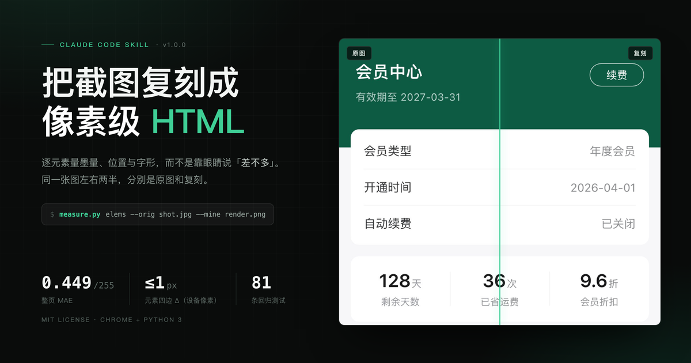

# replicating-screenshots-to-html



[English](#english) · [中文](#中文)

---

## English

Replicate a screenshot (an app screen, a web page, a design export) as HTML/CSS, and converge on
pixel-level accuracy with **numbers** instead of eyeballing "close enough".

This is a skill for coding agents: `SKILL.md` holds the workflow and the acceptance criteria,
`scripts/` holds the measurement tools, `reference/` holds the metric definitions and the pitfalls
we actually hit.

### What it solves

"Looks the same" is not a criterion. Whole-page MAE / SSIM get diluted by large flat backgrounds —
in one measured case a run reported MAE 2.76/255, SSIM 0.968 and every element bbox within 1px,
yet measuring ink mass row by row showed the body text was 20% too light: every glyph on the page
was drawn thin.

So the approach is to break the difference into explainable numbers:

| Metric | What it judges |
|---|---|
| **Ink-mass ratio**, per row / per element | weight, size, color |
| **Four-edge Δ** (ink bbox, device px) | position |
| **Coverage IoU** | shape, sub-pixel phase |
| **Local MAE** | overall difference of low-contrast text (compare before/after only) |
| **Per-glyph column spans / span ratio** | tracking vs. font size |

Three scripts:

- `scripts/measure.py` — measure the original against a render (rows / cols / box / iou / elems / mae)
- `scripts/render.py` — render with headless Chrome at a fixed CSS viewport and device pixel ratio
  (sidesteps the `--window-size` minimum-window trap); `render.sh` is a bash wrapper around it
- `scripts/trace_shape.py` — trace a bitmap outline into an SVG path (SF Symbols, question marks,
  brand marks — not for geometric primitives)

### Install

From the marketplace:

```bash
/plugin install replicating-screenshots-to-html --marketplace zouzanyan/replicating-screenshots
```

Manually: copy the whole directory into your skills directory, keeping `SKILL.md` at its root:

```bash
cp -R replicating-screenshots-to-html ~/.claude/skills/
# or per project:
cp -R replicating-screenshots-to-html .claude/skills/
# Windows: %USERPROFILE%\.claude\skills\replicating-screenshots-to-html\
```

### Requirements

- **Python 3.8+** with `numpy` and `Pillow`

  ```bash
  python3 -m pip install -r requirements.txt   # on Windows: python -m pip
  ```

- **Chrome / Chromium**: `render.py` probes the usual paths on macOS → Linux → Windows. You can also
  point it at a binary with `CHROME=/path/to/chrome python3 scripts/render.py ...`, or run
  `python3 scripts/render.py --check` to see which one it found.
- Optional: **macOS + Swift**, only if you need to render SF Symbols to PNG before tracing them
  (see `SKILL.md`).
- **Platform**: the scripts are Python + `numpy`/`Pillow` with no platform-specific code, so they run
  on macOS / Linux / Windows. **Two differences on Windows**: ① the command is `python`, not
  `python3` — substitute it everywhere below; ② there is no bash, so `render.sh` and `run_tests.sh`
  don't apply — call `python scripts/render.py ...` directly and run the tests file by file.

  **The font and rendering calibration numbers were measured on macOS Chrome**: the PingFang weight
  ladder, SF Pro's continuous weights, `-apple-system` resolving to PingFang, and iOS
  grayscale antialiasing being 8–12% heavier than Chrome's. The workflow still runs on another OS,
  but all those numbers are void there (Windows uses Segoe UI / Microsoft YaHei) and have to be
  re-measured following `reference/metrics.md`.

### Quick start

Paths below are relative to the **skill root** (`skills/replicating-screenshots-to-html/`) —
`cd` in first.

```bash
# 1. Render the replica: 390×844 CSS px at 3x (dpr must match the source image)
python3 scripts/render.py work.html render.png 390 844 3
# on macOS / Linux, bash scripts/render.sh is equivalent; on Windows use python scripts/render.py

# 2. Write an element list (format: reference/elements.example.txt)
#    name,x0,x1,y0,y1[,threshold][,background][,kind][,text-luma]

# 3. Measure everything in one pass
python3 scripts/measure.py elems --orig shot.jpg --mine render.png --rects rects.txt

# 4. First, self-compare on the original (all four edges must be 0, ink ratio 1.000, IoU 1.000)
python3 scripts/measure.py elems --orig shot.jpg --mine shot.jpg --rects rects.txt
```

The self-compare is free: if those numbers are off, suspect your windows, thresholds or the tool —
don't start editing CSS.

A complete worked example (a 390×96 stats card, with source, replica, element list and expected
output): [`examples/stats-card/`](skills/replicating-screenshots-to-html/examples/stats-card/) — about 30 seconds to run.

### Layout

This is the **plugin root**; the whole skill lives under `skills/replicating-screenshots-to-html/`.

```
.claude-plugin/plugin.json  plugin manifest
.claude-plugin/icon.png     listing icon
skills/replicating-screenshots-to-html/
  SKILL.md                    workflow, acceptance criteria, checklist, common mistakes
  reference/metrics.md        metric definitions and 38 measured pitfalls
  reference/elements.example.txt  element-list format
  scripts/measure.py          measurement tool (6 subcommands)
  scripts/render.py           headless Chrome render at fixed viewport + dpr (cross-platform)
  scripts/render.sh           bash wrapper around render.py
  scripts/trace_shape.py      bitmap → SVG path
  examples/stats-card/        minimal end-to-end run (source + replica + list + expected output)
  assets/                     icon and README images
  tests/                      81 tests (assertions against analytic ground truth, not last run's output)
```

### Tests

```bash
bash tests/run_tests.sh                 # macOS / Linux
python -I tests/test_measure.py         # Windows: run the three files separately
                                        #   test_trace_shape.py / test_render.py likewise
```

`-I` is isolated mode (`-E -s`), so it **ignores `PYTHONPATH`** — installing with
`pip install --target` and that trick will fail here with a missing `numpy`. Dependencies installed
into site-packages or a venv are fine.

Expected: all of `test_measure.py` (68), `test_trace_shape.py` (9) and `test_render.py` (4) pass.
On a machine without Chrome those 4 in `test_render.py` are **skipped**, not failed; the other 77
still run. Run the suite before and after touching anything under `scripts/` — the tests lock in
semantics (the threshold means "how far from the background", thin rules are judged on their peak
row/column, `--thr` cannot stay at 200 on a dark background).

### Scope and boundaries

**Works for**: a single static screenshot, pixel-level replication, quantitative alignment of fonts,
weights, tracking and icon shapes.

**Not verified**: multi-screen flows, a single frame mid-animation, canvas or video content. The
dark-theme formulas are symmetric in the background value, but were only validated on synthetic
images and a small real sample.

**A firm boundary**: this workflow reproduces an image very faithfully. If the screenshot is an
invoice, receipt, voucher, exam result or similar document that is meant to stand as a real record,
altering its numbers or text to substitute for the original is forgery — out of scope for this
skill. Test data, redaction, prototype mockups and fixing typos in your own reports are unaffected.

### Version and license

1.0.0 (2026-10-28), MIT License, © 2026 zouzanyan — see `LICENSE`.

---

<a id="中文"></a>
## 中文

把一张截图（App 页面、网页、设计稿导出图）复刻成 HTML/CSS，并用**数字**收敛到像素级，
而不是靠肉眼说「差不多」。

这是一个给 agent 用的 skill：`SKILL.md` 是工作流和判据，`scripts/` 是配套的量测工具，
`reference/` 是踩过的坑和指标定义。

### 它解决什么

「看起来一样」不是判据。全图 MAE / SSIM 会被大片背景稀释 —— 实测有一版报告
MAE 2.76/255、SSIM 0.968、所有 bbox 误差 ≤1px，逐行量墨量后发现正文整体偏细 20%，
整页的字都被画轻了。

所以这里的做法是：把差异拆成可解释的数 ——

| 指标 | 判什么 |
|---|---|
| 逐行/逐元素**墨量比** | 字重、字号、颜色 |
| **四边 Δ**（墨迹 bbox，设备像素） | 位置 |
| **覆盖率 IoU** | 形状、亚像素相位 |
| **局部 MAE** | 低对比文字的总体差异（只比改动前后） |
| **逐字列区间 / 跨度比** | 字距还是字号 |

配套三个脚本：

- `scripts/measure.py` —— 量原图与渲染图（rows / cols / box / iou / elems / mae）
- `scripts/render.py` —— 用 Chrome headless 按固定 CSS 视口 + dpr 渲染（避开 `--window-size` 的最小窗口坑）；`render.sh` 是它的 bash 包装
- `scripts/trace_shape.py` —— 把位图轮廓追踪成 SVG path（SF Symbols、问号、徽标；几何图元不要用）

### 安装

从市场装：

```bash
/plugin install replicating-screenshots-to-html --marketplace zouzanyan/replicating-screenshots
```

手动装：把整个目录放到 skills 目录下，保证 `SKILL.md` 在根：

```bash
cp -R replicating-screenshots-to-html ~/.claude/skills/
# 或者在项目里：
cp -R replicating-screenshots-to-html .claude/skills/
# Windows：拷到 %USERPROFILE%\.claude\skills\replicating-screenshots-to-html\
```

### 依赖

- **Python 3.8+**，`numpy`、`Pillow`

  ```bash
  python3 -m pip install -r requirements.txt   # Windows 上是 python -m pip
  ```

- **Chrome / Chromium**：`render.py` 会按 macOS → Linux → Windows 探测常见路径；
  也可以 `CHROME=/path/to/chrome python3 scripts/render.py ...` 指定，
  或 `python3 scripts/render.py --check` 看它认到了哪个。
- 可选：**macOS + Swift**，只有需要用 SF Symbols 渲染 PNG 再追踪时才要（见 `SKILL.md`）
- **平台**：脚本是 Python + `numpy`/`Pillow`，没有平台相关代码，macOS / Linux / Windows
  都能跑。**Windows 上有两处差别**：① 命令叫 `python` 不叫 `python3`，下文所有
  `python3` 换成 `python`；② 没有 bash，`render.sh` / `run_tests.sh` 用不上 ——
  直接 `python scripts/render.py ...`，测试按下面的「三个文件分别跑」。

  **字体与渲染的标定数据是 macOS Chrome 实测的**：PingFang 的字重阶梯、SF Pro 连续字重、
  `-apple-system` 解析成 PingFang、iOS 抗锯齿比 Chrome 粗 8~12%。换系统后流程照跑，
  但这些数字全部作废（Windows 上是 Segoe UI / 微软雅黑），要按 `reference/metrics.md`
  重新扫一遍。

### 快速开始

下面命令里的相对路径都以 **skill 根**（`skills/replicating-screenshots-to-html/`）为准，
先 `cd` 进去再跑。

```bash
# 1. 渲染复刻稿：390×844 CSS px，3x（dpr 必须和原图一致）
python3 scripts/render.py work.html render.png 390 844 3
# macOS / Linux 上 bash scripts/render.sh 等价；Windows 上用 python scripts/render.py

# 2. 写一份元素清单（格式见 reference/elements.example.txt）
#    名字,x0,x1,y0,y1[,阈值][,底色][,类型][,Y文字]

# 3. 一次量完
python3 scripts/measure.py elems --orig shot.jpg --mine render.png --rects rects.txt

# 4. 先在原图上自比一次（四边必须全 0、墨量比 1.000、IoU 1.000）
python3 scripts/measure.py elems --orig shot.jpg --mine shot.jpg --rects rects.txt
```

清单自比是零成本的：数字不对就先怀疑窗口/阈值/工具，别去改 CSS。

一个现成的完整例子（390×96 的统计卡，含原图、复刻稿、清单和期望输出）：
[`examples/stats-card/`](skills/replicating-screenshots-to-html/examples/stats-card/) —— 跑完三条命令大约 30 秒。

### 目录

以下是**插件根**的结构；skill 本体的全部文件在 `skills/replicating-screenshots-to-html/` 下。

```
.claude-plugin/plugin.json   插件清单
.claude-plugin/icon.png      列表图标
skills/replicating-screenshots-to-html/
  SKILL.md                    工作流、判据、检查表、常见错误
  reference/metrics.md        指标定义与 38 个实测坑
  reference/elements.example.txt  元素清单格式
  scripts/measure.py          量测工具（6 个子命令）
  scripts/render.py           Chrome headless 渲染（跨平台）
  scripts/render.sh           上面那个的 bash 包装
  scripts/trace_shape.py      位图 → SVG path
  examples/stats-card/        最小可跑闭环（原图 + 复刻稿 + 清单 + 期望输出）
  assets/                     图标与 README 配图
  tests/                      81 条测试（断言对着解析解，不是上一次的输出）
```

### 测试

```bash
bash tests/run_tests.sh                 # macOS / Linux
python -I tests/test_measure.py         # Windows：三个测试文件分别跑
                                        #   test_trace_shape.py / test_render.py 同理
```

`-I` 是隔离模式（等于 `-E -s`），**会忽略 `PYTHONPATH`** —— 用 `pip install --target`
那种装法在这里会报找不到 `numpy`。依赖装在 site-packages 或 venv 里就没问题。

期望：`test_measure.py` 68 条、`test_trace_shape.py` 9 条、`test_render.py` 4 条全部通过。
没装 Chrome 的机器上 `test_render.py` 那 4 条会 **skip**（不是失败），另外 77 条照跑。
改 `scripts/` 下任何东西都要先跑它 —— 这些测试锁的是语义（比如阈值是「离底色多远」、
细线按峰值行/列判、`--thr` 在深色底上不能沿用 200）。

### 适用范围与边界

**适用**：单张静态截图、像素级复刻、字体/字重/字距/图标形状的量化对齐。

**没验证过**：多屏流程、动画/过渡中的某一帧、canvas 或视频内容。
深色主题的公式对底色是对称的，但只用合成图和小样本真实页验证过。

**明确的边界**：这套流程会非常认真地还原一张图。如果截图是发票、回单、凭证、
考试成绩这类需要「对外当作真实记录」的东西，改上面的数字/文字去顶替原件属于伪造 ——
不在本 skill 的适用范围。测试数据、脱敏、原型演示、修错别字的报表不受影响。

### 版本与许可

1.0.0（2026-10-28），MIT License，© 2026 zouzanyan —— 见 `LICENSE`。
